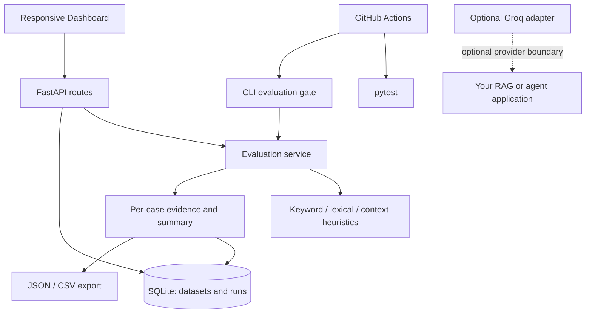

# AgentProof AI — GenAI Evaluation & Regression Testing

**A local-first reliability workbench for repeatable GenAI evaluations, regression detection, and agent execution traces.** AgentProof scores supplied answers against reference material, stores runs, highlights regressions, and offers a command-line quality gate. The default demo is deterministic and needs no API key.

> **Honesty note:** the included evaluator uses lexical heuristics. It does not prove semantic equivalence, factual correctness, genuine source support, tool-call correctness, or task success. The built-in data is synthetic documentation QA data, not an industry benchmark.

## Features
- Trace ingestion and inspection for LLM, tool, retrieval, chain, and internal spans; preserves inputs/outputs, attributes, errors, parent-child relationships, and timestamps.
- Trace validation for duplicate span IDs, missing parent spans, invalid timestamps, and duplicate trace IDs; wall-clock trace duration avoids double-counting nested spans.
- Optional evidence checks for citation IDs against source-document IDs and expected-versus-actual tool-call lists. These checks validate supplied structured data, not truthfulness of an agent's underlying claims.
- 18 synthetic sample cases covering ordinary questions, missing context, and edge cases.
- JSON and CSV dataset import with Pydantic validation and unique-ID checks.
- Keyword coverage, answer/reference lexical similarity, context-token overlap, missing-context and empty-answer checks, and citation-label presence.
- Explicit `unscored` status when there are no applicable metrics.
- SQLite evaluation history, before/after comparisons, newly passing/failing IDs, JSON/CSV export.
- Responsive dashboard and FastAPI docs.
- CLI CI gate and GitHub Actions workflow.
- Optional Groq adapter; not needed by the default path.

## Quick start (Windows PowerShell)

```powershell
cd .\agentproof-ai
py -3.12 -m venv .venv
.\.venv\Scripts\Activate.ps1
python -m pip install --upgrade pip
pip install -r requirements.txt
Copy-Item .env.example .env
uvicorn app.main:app --reload
```

Open **http://127.0.0.1:8000** for the dashboard, **http://127.0.0.1:8000/docs** for interactive API docs, and **http://127.0.0.1:8000/health** for health status. Python 3.12 is recommended; the code also uses modern type syntax.

If PowerShell blocks activation, run `Set-ExecutionPolicy -Scope Process -ExecutionPolicy Bypass` in that terminal and activate again. You can alternatively run `.\.venv\Scripts\python.exe -m pip install -r requirements.txt` and `.\.venv\Scripts\python.exe -m uvicorn app.main:app --reload` without activating.

## Run tests and CI gate

```powershell
python -m pytest -q
python scripts/evaluate_dataset.py --dataset data/demo_cases.json --min-pass-rate 0.80
python scripts/evaluate_dataset.py --dataset data/demo_cases.json --min-pass-rate 0.80 --report artifacts\demo-report.json
```

The CLI exits `0` when the scored-case pass rate meets the minimum, `1` when the gate fails, and `2` for invalid input or thresholds. It does not call a live LLM. CI runs the tests and the same sample gate. **Run these commands in your environment and record the actual output; do not claim results before they run.**

## Docker

```powershell
docker compose up --build
```

Visit http://localhost:8000. SQLite persists in a named Docker volume. Stop with `Ctrl+C`; run `docker compose down` to stop and `docker compose down -v` only if you intentionally want to delete persisted data.

## Architecture



## API overview
- `GET /health` — health and database connectivity.
- `GET /api/datasets` — list datasets.
- `POST /api/datasets/import` — import a validated JSON body.
- `POST /api/datasets/import-file` — multipart JSON or CSV upload.
- `GET /api/datasets/{dataset_id}` — dataset details.
- `POST /api/evaluations` — run and persist evaluation.
- `GET /api/evaluations` — recent runs.
- `GET /api/evaluations/{run_id}` — saved run and detailed results.
- `GET /api/evaluations/compare?baseline_id=1&candidate_id=2` — compare runs.
- `GET /api/evaluations/{run_id}/export?format=json|csv` — download report.
- `POST /api/traces` — ingest an execution trace containing spans.
- `GET /api/traces?status=ok|error&limit=50` — list recent traces.
- `GET /api/traces/{trace_id}` — inspect full trace and spans.

### Example: start a run

```powershell
Invoke-RestMethod -Method Post -Uri http://127.0.0.1:8000/api/evaluations -ContentType 'application/json' -Body '{"dataset_id":1,"pass_threshold":0.65}'
```

Example response shape (scores depend on the actual dataset and configuration):

```json
{
  "id": 1,
  "dataset_name": "AgentProof Demo Benchmark",
  "summary": {
    "total_cases": 18,
    "scored_cases": 18,
    "passed_cases": 17,
    "failed_cases": 1,
    "unscored_cases": 0,
    "pass_rate": 0.9444,
    "average_score": 0.91,
    "pass_threshold": 0.65
  },
  "results": [{"case_id":"rag-001","status":"passed","score":0.95}]
}
```

The values above illustrate the response shape only; they are **not reported benchmark results**. Check the live response for actual values.

## Metrics and limitations
- **Expected-keyword coverage:** fraction of configured keywords found as case-insensitive substrings. Does not understand synonyms or negation.
- **Answer/reference lexical similarity:** token-multiset Dice overlap. It measures word overlap, not meaning.
- **Context-word overlap:** fraction of answer tokens found in reference context. Common words can inflate it; it is not entailment or groundedness proof.
- **Citation presence:** checks whether configured citation labels appear in the supplied actual-citation list. It does not validate the cited document or claim.
- **Missing context / empty answer:** explicit diagnostics; an empty answer is unscored because a lexical score would be misleading.
- The demo supplies expected answers as deterministic mock outputs unless an actual answer override is supplied. Connect your own app outputs for meaningful evaluation.
- Run comparison currently identifies regressions by case ID shared between runs; it is not a semantic diff.
- No authentication or multi-user tenancy is implemented. Run only on a trusted local network unless you add access controls.
- The Groq adapter is an optional provider boundary and is not wired into the default evaluation route. Install `groq` separately and set `GROQ_API_KEY` only if using it.

### Example: ingest an execution trace

The included `data/example_trace.json` is synthetic and intentionally contains an example error span. Send it from PowerShell:

```powershell
$trace = Get-Content .\data\example_trace.json -Raw
Invoke-RestMethod -Method Post -Uri http://127.0.0.1:8000/api/traces -ContentType 'application/json' -Body $trace
Invoke-RestMethod -Uri http://127.0.0.1:8000/api/traces/demo-agent-run-001
```

The dashboard's **Agent traces** section lists ingested traces and expands span-level inputs, outputs, attributes, and errors. Avoid sending secrets, access tokens, payment data, or sensitive personal information in trace payloads.

## Dataset format
JSON may be a list of cases or an object with `name`, `description`, and `cases`. Required per case: `id`, `question`, `expected_answer`; optional fields include `reference_context`, `expected_keywords`, `expected_citations`, `actual_answer`, and `actual_citations`. CSV uses matching column names; keyword/citation fields can be semicolon-separated or JSON arrays. IDs must be unique in a dataset.

## Security
- Never commit `.env`, API keys, tokens, or private datasets.
- Uploaded files are size-limited to 2 MB and parsed as JSON/CSV; only import data you trust.
- This MVP does not yet provide authentication, authorization, rate limiting, or tenant isolation. Do not expose it publicly or use it to store sensitive production traces without adding and validating these controls.
- The optional provider adapter sends its prompt to the configured third-party provider when invoked.

## Screenshots
Capture real screenshots after running the app and add them under `docs/screenshots/`. Suggested shots: dashboard after a run, expanded failure evidence, and run comparison. Do not add fabricated UI screenshots or pretend the illustrative API values above were observed.

## Development
```powershell
python -m pytest -q
python scripts/evaluate_dataset.py --dataset data/demo_cases.json --min-pass-rate 0.80
```

## Production-readiness status

This repository is a functional engineering MVP, **not a hardened production SaaS**. Before exposing it to untrusted networks, implement and validate:

- Authentication, authorization, tenant isolation, per-tenant quotas, and audit logs.
- A deployment-grade database/migration strategy (PostgreSQL for concurrent multi-user deployments), backups, restore drills, retention policies, and encryption at rest/in transit.
- Request-size limits at the proxy, rate limiting, security headers, CORS allowlists, CSRF strategy if cookie auth is introduced, and dependency/security scanning.
- Background workers and bounded concurrency for expensive evaluations; cancellation, retries, timeouts, idempotency, and dead-letter handling.
- Real provider integrations with cost budgets, secret management, redaction, and explicit user consent before sending data to third-party model providers.
- Calibrated semantic/judge evaluation and retrieval precision/recall using a labeled benchmark. Any LLM judge must report its model/prompt/version and is not ground truth.
- OpenTelemetry-compatible exporters, alerting, SLOs, retention controls, and tested incident/restore procedures.

## Roadmap
1. Authentication, tenant-scoped storage and audit events.
2. PostgreSQL + migrations, backup/restore docs, and deployment profiles.
3. Optional semantic/judge adapters with versioned prompts and calibration tests.
4. Retrieval-specific metrics, source-span citation validation, and agent task-success assertions.
5. GitHub PR annotations, async evaluation workers, quotas and operational telemetry.

## Contributing
Issues and pull requests are welcome. Please add focused tests, document metric limitations, avoid real private data, and keep the default test suite network-free. See [CONTRIBUTING.md](CONTRIBUTING.md).

## License
MIT — see [LICENSE](LICENSE).
